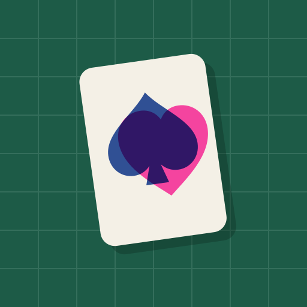

# Misdeal

A poker roguelike for iPad, played in the browser. It follows the run structure of Balatro (blinds and antes, chips × mult scoring, Jokers, a shop, booster packs, hand levels, vouchers and tags). The art, names, Joker roster and theme are original: a risograph print shop on a cutting mat.

It is a static site with no server, so it runs on Firebase Hosting's free Spark plan. Runs are saved on the device, and once loaded it also works offline.

## What's in it

- 52-card deck with all poker hands, including three hidden ones that need modified cards
- 67 Jokers (common, uncommon, rare), each drawn procedurally as a two-ink printed character
- 12 Plates that level up poker hands, 22 Stamps that change cards, 12 vouchers, 12 skip tags
- 18 Boss Blinds, with two harder final bosses at ante 8, plus endless mode after you win
- Card enhancements, editions and seals; 8 decks; seeded runs
- Four difficulty levels (Normal, Hard, Expert, Master); winning on one unlocks the next
- Start with the Plain Deck and unlock a new deck for every ante you reach (3 through 8, then a win), plus a Joker collection to fill
- Original generative music and synthesized sound effects, all made live in the browser
- Touch controls built for iPad: Discard under your left thumb, Play under your right, drag to reorder cards and Jokers, press and hold anything to read it
- Works in landscape and portrait, and full screen when added to the Home Screen

## Run it locally

```sh
npm install
npm run dev        # http://localhost:5173
npm test           # engine tests
npm run build      # production build in dist/
npm run sim -- base 2000    # balance simulator (see below)
```

## Balance simulator

`sim/` holds an honest bot that plays full runs with the real engine and a runner that spreads runs across CPU cores. Experiments:

- `npm run sim -- base 2000`: win rate, where runs end, and how deadly each boss is
- `npm run sim -- jokers 200`: each Joker's worth, measured with paired runs (same seeds with and without it)
- `npm run sim -- decks 500` and `npm run sim -- diff 800`: compare decks and difficulty levels

Results land in `sim/out/`. The bot is weaker than a good player, so read the numbers as comparisons, not absolute win rates.

Open `http://localhost:5173/#gallery` while developing to see every piece of art on one page.

## Deploy to Firebase Hosting (free Spark plan)

1. Create a project at [console.firebase.google.com](https://console.firebase.google.com). New projects start on the free Spark plan, and Hosting doesn't need billing.
2. Sign in from this folder: `npx firebase-tools login`
3. Put your project ID in `.firebaserc` in place of `your-firebase-project-id`, or run `npx firebase-tools use --add`.
4. Build and deploy: `npm run deploy`

The site goes live at `https://<project-id>.web.app`. This uses Firebase Hosting only, not App Hosting, so there is no server and nothing to pay for.

## Play on the iPad

Open the `web.app` link in Safari, tap Share, then **Add to Home Screen**. It then opens full screen like an app, keeps your run between sessions and plays offline.

## Project layout

- `src/game/`: the rules engine (pure TypeScript, seeded RNG, no UI), with tests in `engine.test.ts`
- `src/ui/`: React screens, the scoring animation and touch handling
- `src/ui/art/`: all card art as SVG components
- `build/sw-template.js`: the offline service worker; `vite.config.ts` fills in the file list at build time
- `firebase.json`: hosting config with cache headers for hashed assets and the service worker

## License

MIT, see [LICENSE](LICENSE). Misdeal is a fan-made game inspired by Balatro's mechanics; it is not affiliated with Balatro or its creators, and contains none of its art or text.
